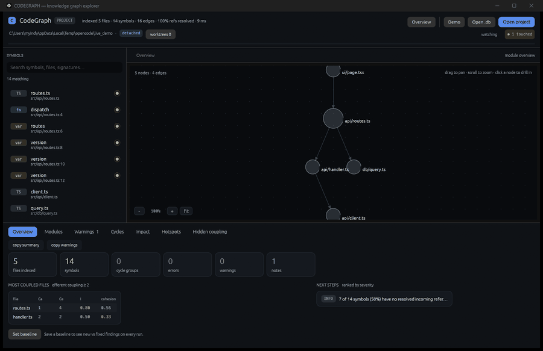

# CodeGraph Desktop

**A native desktop app that indexes a codebase itself and answers: what is
expensive to change here, and what should I fix first?**

[](https://github.com/aaryxnblondead/codegraph-desktop/actions/workflows/ci.yml)
[](LICENSE)
[](CONTRIBUTING.md#quick-start)
[](https://github.com/aaryxnblondead/codegraph-desktop/labels/good%20first%20issue)



*Five-file sample project. Saving `routes.ts` re-indexes in ~30 ms and lights up
the file, its rows and its module node.*

## The problem

Most "dependency graph" tools show you a picture and stop there. You still have
to work out which module is unstable, which cycle to break, which file is
actually risky to touch, and whether last week's cleanup made things better or
worse.

CodeGraph Desktop indexes the project, keeps the graph current while you edit,
and turns it into findings you can act on — with a location, a reason, and a
suggestion.

### Why not just use an existing graph tool?

If you want a JS-only dependency check in CI, `dependency-cruiser` is more mature.
If you want org-wide behavioural dashboards, CodeScene is built for that. This
project targets the local, account-free middle: a clickable graph, findings that
name the symbol and line, and a baseline that says *0 new · 12 fixed*.
[docs/COMPARISON.md](docs/COMPARISON.md) has the honest table, including where
this tool is weaker.

## What it does

- **Indexes the project itself.** TypeScript/JavaScript, Python and Rust via
  tree-sitter; imports and symbols resolved in tiers with explicit confidence.
  No `codegraph.db` required (legacy databases still open).
- **Stays current.** A file watcher re-indexes only what changed; edited files
  and their modules light up in the graph and the list.
- **Finds design problems.** Module coupling and cohesion, file-level cycles
  with the cheapest edges to cut, change impact, complexity, git churn hotspots,
  hidden coupling, layer-rule violations.
- **Points at the code.** Findings read
  `app/admin/actions.ts::applyRefund:412–479`, not "this file has a problem".
- **Tracks regressions.** Baselines show `0 new · 12 fixed` instead of a count
  that only ever grows.
- **Fits CI.** `cg_index` writes JSON/Markdown and exits `2` on new findings.
- **Reads git, never writes it.** Branch, HEAD and worktrees; open any worktree
  as the indexed root.

## Quick start

Prerequisites: **Rust** (stable) and **a C compiler**
(bundled SQLite + tree-sitter grammars), and optionally **git**.

```bash
git clone https://github.com/aaryxnblondead/codegraph-desktop.git
cd codegraph-desktop
cargo run --release
```

Then press **Ctrl+O** and pick a folder. The app indexes it and shows the module
overview. No config file, database or account is needed.

Headless:

```bash
cargo run --release --bin cg_index -- . --no-git
```

```text
41 files · 737 symbols · 2200 edges · 18% refs resolved · 402 ms
findings: 3 error · 29 warn · 9 info
by rule: low_cohesion 11, complex_function 9, main_sequence 7, god_file 5, …
top findings:
  ERROR complex_function  `src/warnings.rs::run_warnings_reporting:137–610` has cyclomatic complexity 50
```

Compare two runs, and gate CI on regressions:

```bash
cg_index . --json report.json --save-baseline baseline.json
cg_index . --json report.json --baseline baseline.json --fail-on-new error
```

## The interface

| Area | What it answers |
|---|---|
| **Overview** | How big is this, what changed since the baseline, where is the coupling |
| **Modules** | Ca, Ce, instability, abstractness, distance, cohesion, complexity per module |
| **Warnings** | Every finding, filterable by severity, with *why* and *what to try* |
| **Cycles** | Each dependency loop and the cheapest edges that break it |
| **Impact** | What breaks if this symbol changes; what it depends on |
| **Hotspots** | Files that change often, ranked by churn |
| **Hidden coupling** | Files that change together but are not linked |

Search, breadcrumbs, arrow-key navigation, `Ctrl+O`, `Esc`, and a
copy-to-clipboard action on every pane (summary, warnings, one warning, cycle,
impact, module table, symbol reference).

## What a finding looks like

```text
ERROR complex_function — `app/admin/actions.ts::updateLeadDetails:231–366`
      has cyclomatic complexity 52
  → Extract branches into named functions or a lookup table.
```

Thresholds are calibrated, not aspirational:

- `complex_function`: symbol-level, JSX markup excluded, WARN ≥ 20, ERROR ≥ 45;
  render functions never go above WARN.
- `god_file`: needs 300 LOC / 40 symbols before degree counts, and names its
  three largest symbols.
- `low_cohesion`: 15+ symbols, 4+ disconnected groups, no dominant group; lists
  ten files plus one volume note.
- `index_quality`: unresolved references, explicitly *not* a dead-code list.

Accept a finding in committed config:

```json
{ "suppress": [{ "rule": "complex_function", "path": "app/legacy/**", "reason": "vendor port" }] }
```

or next to the code:

```ts
// codegraph-ignore complex_function
```

## Performance

Measured on an 867-file TypeScript project (release build, Windows laptop):

| Operation | Time |
|---|---|
| Cold index | ~20 s |
| Warm re-index (content-hash cache) | ~1.2 s |
| Load the saved graph at startup | ~190 ms |
| Save → updated graph (watch + incremental) | ~30 ms |

The UI never renders the whole graph: 40 modules, 160 files, 80 symbols per
view, with layout computed once and a pure draw path.

## How it is built

- Rust 2021, `eframe`/`egui` for the window, `tree-sitter` for parsing,
  `rusqlite` for the cache, `petgraph` for graph algorithms.
- The library is headless except `src/ui.rs`; analysis, parsing, git and
  reporting are testable without a window.
- Nothing is written inside the indexed project. Caches and settings live under
  the OS app-data directory; git access is read-only.
- 141 tests, `clippy -D warnings` and `fmt` clean, CI on Windows/macOS/Linux.

## Documentation

- [ARCHITECTURE.md](ARCHITECTURE.md) — modules and data flow
- [docs/METRICS.md](docs/METRICS.md) — every formula in plain language
- [docs/FAQ.md](docs/FAQ.md) — troubleshooting and "is this finding real?"
- [docs/ROADMAP.md](docs/ROADMAP.md) — what is next, and scoped first issues
- [docs/COMPARISON.md](docs/COMPARISON.md) — how it differs from other tools
- [docs/PROMOTION.md](docs/PROMOTION.md) — launch notes and shareable copy
- [DECISIONS.md](DECISIONS.md) — why things are the way they are
- [PROGRESS.md](PROGRESS.md) — phase log with measurements

## Contributing

Contributions of every size are welcome — a typo fix, a new rule, a language
extractor. Start with [CONTRIBUTING.md](CONTRIBUTING.md); it has copy-paste
setup, change recipes, and the exact commands CI runs.

New here? Look for
[`good first issue`](https://github.com/aaryxnblondead/codegraph-desktop/labels/good%20first%20issue):
each one names the files to touch and how to verify the result. If you are
unsure whether something is in scope, open an issue — a short description is
enough.

## Maintainer

Built and maintained by [@aaryxnblondead](https://github.com/aaryxnblondead).
Questions: open a discussion, or email **aaryansingh2810@gmail.com**.
Security reports: see [SECURITY.md](SECURITY.md).

## License

[MIT](LICENSE) © 2026 aaryxnblondead

---

If this saved you a triage session, a ⭐ helps other people find it. If it gave
you a wrong answer, an issue helps more — wrong edges and noisy rules are the
bugs that matter most here.
